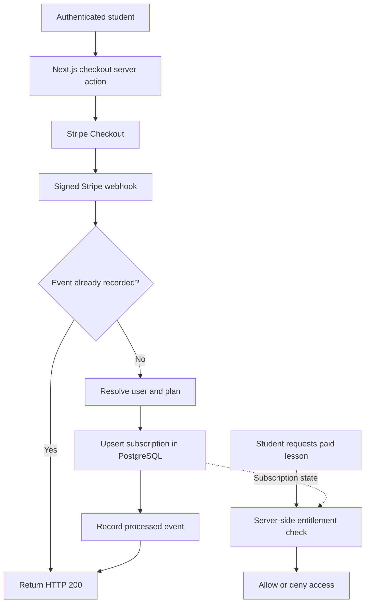

# TheQuranCampus — Payment and Entitlement Engineering

**Taseen Rahman | Full-stack engineering portfolio**

TheQuranCampus is a subscription-based Qur'an learning platform I independently developed. This showcase focuses on the Stripe integration and how payment events are translated into server-side access to paid learning material. The planned launch was postponed; this is a code walkthrough, not a claim of live payment volume.

## Architecture

Built with Next.js, TypeScript, Stripe, Clerk, Prisma and PostgreSQL, with Mux used elsewhere in the platform for video delivery.



## Code walkthrough

| Sample | What it demonstrates |
| --- | --- |
| [checkout.ts](samples/checkout.ts) | Authenticated subscription checkout, validated plan selection, Stripe customer mapping and user metadata. |
| [webhook.ts](samples/webhook.ts) | Raw request body signature verification, event IDs, duplicate delivery detection and failure responses. |
| [subscription-sync.ts](samples/subscription-sync.ts) | Stripe subscription status mapping, user and plan resolution, and idempotent upserts. |
| [entitlement.ts](samples/entitlement.ts) | Server-side checks for authentication, publication, paid access and learning prerequisites. |
| [schema.prisma](samples/schema.prisma) | Extract of the relational models and database uniqueness constraints. |

## Idempotency

Stripe may deliver an event more than once. The original implementation checks whether the event ID has already been recorded:

```ts
const seen = await prisma.processedWebhook.findUnique({
  where: { eventId: event.id },
});

if (seen) {
  return new Response("Already processed", { status: 200 });
}
```

The database enforces uniqueness on `ProcessedWebhook.eventId`. After successful handling, the event is recorded. A repeat delivery after that point returns successfully without repeating processing.

There is a second layer of idempotency at the subscription level:

```ts
await prisma.subscription.upsert({
  where: { stripeSubscriptionId: stripeSub.id },
  create: {
    ...data,
    userId,
    stripeCustomerId: customerId,
    stripeSubscriptionId: stripeSub.id,
  },
  update: data,
});
```

The unique Stripe subscription ID ensures multiple events referring to one subscription target the same local record rather than creating duplicate subscriptions. This does not by itself prevent stale updates.

## From payment to course access

The checkout action obtains the authenticated user, checks the requested plan and passes the internal user ID in Stripe subscription metadata. The webhook verifies the Stripe signature before dispatching supported events. Subscription synchronisation retrieves the subscription for checkout completion, resolves the local user and plan, and persists the status and billing period.

Paid, non-preview course items are authorised against the local subscription at request time. The current policy permits ACTIVE, TRIALING and PAST_DUE subscriptions whose current period end is in the future. Learning prerequisites are evaluated separately. The checkout redirect itself does not grant access.

## What I would improve before wider rollout

The snippets reflect the implementation as built, not a fully hardened exactly-once workflow.

- **Atomic processing and concurrency:** the existing check, upsert and processed-event insert are separate operations. Concurrent deliveries can both pass the initial check; a crash between writes can also cause reprocessing. I would use a transaction to claim the unique event and apply the subscription changes, handle conflicts explicitly and return success only after durable commit.
- **Out-of-order events:** checkout completion retrieves current Stripe state, but subscription lifecycle events currently use their payload. I would reconcile against authoritative Stripe state and serialise or guard competing updates per subscription to avoid overwriting newer state.
- **Welcome emails:** I would persist an outbox job in the same transaction as a newly granted entitlement, with a unique business key. A separate worker would retry failures with exponential backoff, use provider idempotency where available and surface exhausted jobs for review. Email delivery should not block course access.
- **Recovery and monitoring:** I would periodically reconcile Stripe subscriptions against local state, track webhook errors and retry backlog, and correlate logs using event, subscription and internal user identifiers.
- **Verification:** I would test signature failures, sequential and concurrent duplicates, out-of-order deliveries, transaction rollback, provider failures and unauthorised access using Stripe CLI, integration tests and Playwright. This showcase does not include or claim an executed test suite.

## Scope

These are selected source files from the original application. Imports and schema relationships intentionally refer to the wider application; the repository is a reading sample, not a standalone runnable project. No API keys, environment files or student records are included.
